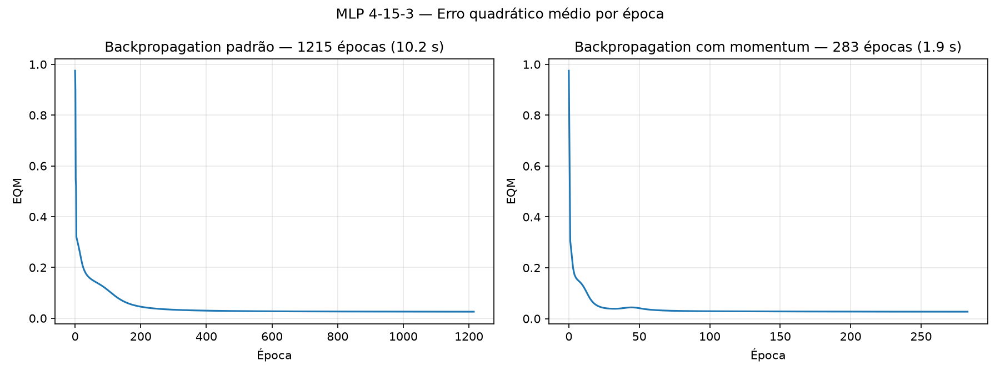

# Lab. Inteligência Artificial — Perceptron Multicamadas (classificação de conservantes)

CEFET-MG Campus VIII – Varginha · Prof. Lázaro Eduardo da Silva · 14/10/2026

**Aluno(a):** ______________________________

Os resultados numéricos abaixo foram gerados por `mlp.py`. Os pesos iniciais são sorteados
uma única vez no intervalo [0, 1) (`numpy.random.default_rng(1)`) e reutilizados nos dois
treinamentos, como pede o item 2, de modo que os resultados são reproduzíveis.

---

## Configuração da rede

- Topologia 4-15-3: 4 entradas (x1…x4), 15 neurônios na camada escondida e 3 na de saída.
- Função de ativação logística `g(u) = 1 / (1 + e^(−u))` em todos os neurônios.
- Bias tratado como entrada fixa `−1` em cada camada (W1: 15×5, W2: 3×16).
- Treinamento online (pesos ajustados a cada padrão), 130 amostras do Anexo.
- EQM por época: `E = (1/p) · Σ_k ½ · Σ_j (d_j(k) − y_j(k))²`.
- Critério de parada: `|EQM(época) − EQM(época anterior)| ≤ ε`, com ε = 10⁻⁶.

## Itens 1 e 2 — Treinamentos

**Backpropagation padrão** (η = 0,1):
`W(n+1) = W(n) + η · δ · y`

**Backpropagation com momentum** (η = 0,1, α = 0,9), partindo das mesmas matrizes iniciais:
`W(n+1) = W(n) + α · (W(n) − W(n−1)) + η · δ · y`

| Algoritmo | Épocas | EQM final | Tempo de processamento (s) |
|---|---|---|---|
| Backpropagation padrão | 1215 | 0.025827 | 10.21 |
| Backpropagation com momentum | 283 | 0.027248 | 1.89 |

> O tempo de processamento depende da máquina; os valores acima foram medidos com
> `time.perf_counter()` apenas no laço de treinamento.

### Gráficos do EQM por época



**Análise:** os dois treinamentos chegam a um EQM final praticamente igual (~0,026), mas o
momentum converge em cerca de **4,3 vezes menos épocas** (283 × 1215) e em tempo
proporcionalmente menor. O termo `α · ΔW(n−1)` acumula a direção dos ajustes anteriores:
nas regiões planas da superfície de erro (o "platô" visível entre as épocas 200 e 1200 do
backpropagation padrão) ele acelera a descida, e nas regiões de oscilação ele amortece as
mudanças de sentido. A pequena ondulação próxima à época 45 no gráfico do momentum é
justamente o efeito da inércia ao passar por uma região de curvatura maior.

## Item 3 — Pós-processamento

Implementado em `pos_processar()`, aplicado somente às saídas do conjunto de teste:

```
y_pós = 1, se y ≥ 0,5
        0, se y < 0,5
```

Uma amostra é considerada acertada quando os três valores pós-processados
(y1 pós, y2 pós, y3 pós) coincidem com (d1, d2, d3).

## Item 4 — Validação com o conjunto de teste

### Rede treinada com backpropagation padrão

| Amostra | x1 | x2 | x3 | x4 | d1 | d2 | d3 | y1 pós | y2 pós | y3 pós | y1 | y2 | y3 | Acerto |
|---|---|---|---|---|---|---|---|---|---|---|---|---|---|---|
| 1 | 0.8622 | 0.7101 | 0.6236 | 0.7894 | 0 | 0 | 1 | 0 | 0 | 1 | 0.0000 | 0.0029 | 0.9970 | sim |
| 2 | 0.2741 | 0.1552 | 0.1333 | 0.1516 | 1 | 0 | 0 | 1 | 0 | 0 | 0.9994 | 0.0010 | 0.0000 | sim |
| 3 | 0.6772 | 0.8516 | 0.6543 | 0.7573 | 0 | 0 | 1 | 0 | 0 | 1 | 0.0000 | 0.0026 | 0.9974 | sim |
| 4 | 0.2178 | 0.5039 | 0.6415 | 0.5039 | 0 | 1 | 0 | 0 | 1 | 0 | 0.0026 | 0.9863 | 0.0009 | sim |
| 5 | 0.7260 | 0.7500 | 0.7007 | 0.4953 | 0 | 0 | 1 | 0 | 0 | 1 | 0.0000 | 0.0846 | 0.9319 | sim |
| 6 | 0.2473 | 0.2941 | 0.4248 | 0.3087 | 1 | 0 | 0 | 1 | 0 | 0 | 0.9400 | 0.0616 | 0.0000 | sim |
| 7 | 0.5682 | 0.5683 | 0.5054 | 0.4426 | 0 | 1 | 0 | 0 | 1 | 0 | 0.0009 | 0.9876 | 0.0022 | sim |
| 8 | 0.6566 | 0.6715 | 0.4952 | 0.3951 | 0 | 1 | 0 | 0 | 1 | 0 | 0.0002 | 0.9803 | 0.0087 | sim |
| 9 | 0.0705 | 0.4717 | 0.2921 | 0.2954 | 1 | 0 | 0 | 1 | 0 | 0 | 0.9740 | 0.0296 | 0.0000 | sim |
| 10 | 0.1187 | 0.2568 | 0.3140 | 0.3037 | 1 | 0 | 0 | 1 | 0 | 0 | 0.9951 | 0.0058 | 0.0000 | sim |
| 11 | 0.5673 | 0.7011 | 0.4083 | 0.5552 | 0 | 1 | 0 | 0 | 1 | 0 | 0.0002 | 0.9795 | 0.0086 | sim |
| 12 | 0.3164 | 0.2251 | 0.3526 | 0.2560 | 1 | 0 | 0 | 1 | 0 | 0 | 0.9888 | 0.0122 | 0.0000 | sim |
| 13 | 0.7884 | 0.9568 | 0.6825 | 0.6398 | 0 | 0 | 1 | 0 | 0 | 1 | 0.0000 | 0.0007 | 0.9992 | sim |
| 14 | 0.9633 | 0.7850 | 0.6777 | 0.6059 | 0 | 0 | 1 | 0 | 0 | 1 | 0.0000 | 0.0017 | 0.9982 | sim |
| 15 | 0.7739 | 0.8505 | 0.7934 | 0.6626 | 0 | 0 | 1 | 0 | 0 | 1 | 0.0000 | 0.0005 | 0.9995 | sim |
| 16 | 0.4219 | 0.4136 | 0.1408 | 0.0940 | 1 | 0 | 0 | 1 | 0 | 0 | 0.9951 | 0.0066 | 0.0000 | sim |
| 17 | 0.6616 | 0.4365 | 0.6597 | 0.8129 | 0 | 0 | 1 | 0 | 0 | 1 | 0.0000 | 0.3093 | 0.7073 | sim |
| 18 | 0.7325 | 0.4761 | 0.3888 | 0.5683 | 0 | 1 | 0 | 0 | 1 | 0 | 0.0010 | 0.9846 | 0.0020 | sim |

**Taxa de acerto:** 18/18 = 100.00%

### Rede treinada com backpropagation com momentum

| Amostra | x1 | x2 | x3 | x4 | d1 | d2 | d3 | y1 pós | y2 pós | y3 pós | y1 | y2 | y3 | Acerto |
|---|---|---|---|---|---|---|---|---|---|---|---|---|---|---|
| 1 | 0.8622 | 0.7101 | 0.6236 | 0.7894 | 0 | 0 | 1 | 0 | 0 | 1 | 0.0000 | 0.0007 | 0.9988 | sim |
| 2 | 0.2741 | 0.1552 | 0.1333 | 0.1516 | 1 | 0 | 0 | 1 | 0 | 0 | 0.9986 | 0.0024 | 0.0000 | sim |
| 3 | 0.6772 | 0.8516 | 0.6543 | 0.7573 | 0 | 0 | 1 | 0 | 0 | 1 | 0.0000 | 0.0010 | 0.9984 | sim |
| 4 | 0.2178 | 0.5039 | 0.6415 | 0.5039 | 0 | 1 | 0 | 0 | 1 | 0 | 0.0037 | 0.9932 | 0.0031 | sim |
| 5 | 0.7260 | 0.7500 | 0.7007 | 0.4953 | 0 | 0 | 1 | 0 | 0 | 1 | 0.0000 | 0.1131 | 0.8894 | sim |
| 6 | 0.2473 | 0.2941 | 0.4248 | 0.3087 | 1 | 0 | 0 | 1 | 0 | 0 | 0.9161 | 0.0933 | 0.0000 | sim |
| 7 | 0.5682 | 0.5683 | 0.5054 | 0.4426 | 0 | 1 | 0 | 0 | 1 | 0 | 0.0015 | 0.9928 | 0.0062 | sim |
| 8 | 0.6566 | 0.6715 | 0.4952 | 0.3951 | 0 | 1 | 0 | 0 | 1 | 0 | 0.0006 | 0.9888 | 0.0139 | sim |
| 9 | 0.0705 | 0.4717 | 0.2921 | 0.2954 | 1 | 0 | 0 | 1 | 0 | 0 | 0.9497 | 0.0555 | 0.0000 | sim |
| 10 | 0.1187 | 0.2568 | 0.3140 | 0.3037 | 1 | 0 | 0 | 1 | 0 | 0 | 0.9911 | 0.0108 | 0.0000 | sim |
| 11 | 0.5673 | 0.7011 | 0.4083 | 0.5552 | 0 | 1 | 0 | 0 | 1 | 0 | 0.0004 | 0.9844 | 0.0197 | sim |
| 12 | 0.3164 | 0.2251 | 0.3526 | 0.2560 | 1 | 0 | 0 | 1 | 0 | 0 | 0.9812 | 0.0229 | 0.0000 | sim |
| 13 | 0.7884 | 0.9568 | 0.6825 | 0.6398 | 0 | 0 | 1 | 0 | 0 | 1 | 0.0000 | 0.0004 | 0.9993 | sim |
| 14 | 0.9633 | 0.7850 | 0.6777 | 0.6059 | 0 | 0 | 1 | 0 | 0 | 1 | 0.0000 | 0.0007 | 0.9988 | sim |
| 15 | 0.7739 | 0.8505 | 0.7934 | 0.6626 | 0 | 0 | 1 | 0 | 0 | 1 | 0.0000 | 0.0003 | 0.9995 | sim |
| 16 | 0.4219 | 0.4136 | 0.1408 | 0.0940 | 1 | 0 | 0 | 1 | 0 | 0 | 0.9875 | 0.0179 | 0.0000 | sim |
| 17 | 0.6616 | 0.4365 | 0.6597 | 0.8129 | 0 | 0 | 1 | 0 | 0 | 1 | 0.0000 | 0.1099 | 0.8776 | sim |
| 18 | 0.7325 | 0.4761 | 0.3888 | 0.5683 | 0 | 1 | 0 | 0 | 1 | 0 | 0.0011 | 0.9895 | 0.0086 | sim |

**Taxa de acerto:** 18/18 = 100.00%

**Análise:** as duas redes classificam corretamente as 18 amostras de teste (**100% de
acerto**). As saídas reais ficam, em geral, muito próximas de 0 ou 1; os casos de menor
"confiança" são as amostras 5, 6 e 17 (por exemplo, na amostra 17 o backpropagation padrão
fornece y2 = 0,31 e y3 = 0,71), que estão próximas da fronteira entre os tipos B e C — mesmo
assim o arredondamento simétrico leva à classe correta.
