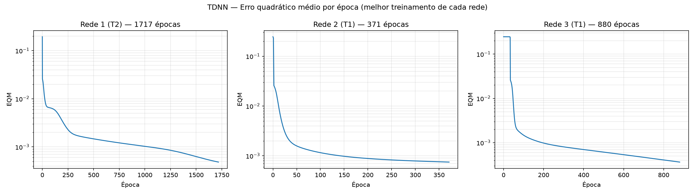
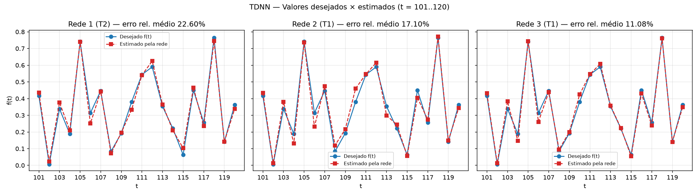

# Lab. Inteligência Artificial — Perceptron Multicamadas TDNN (previsão de preços)

CEFET-MG Campus VIII – Varginha · Prof. Lázaro Eduardo da Silva · 14/10/2026

**Aluno(a):** ______________________________

Os resultados numéricos abaixo foram gerados por `tdnn.py`. Em cada treinamento o gerador de
números aleatórios é reiniciado com uma semente diferente (`default_rng(1)`, `(2)`, `(3)` para
T1, T2 e T3), de modo que os pesos iniciais (valores em [0, 1)) são distintos entre si e os
resultados são reproduzíveis.

---

## Configuração

- Topologia TDNN: entradas x(t−1), …, x(t−p), uma camada escondida com N1 neurônios e
  um neurônio de saída f(t). Bias como entrada fixa `−1` em cada camada.
- Função de ativação logística em todos os neurônios.
- Backpropagation com momentum, treinamento online:
  `W(n+1) = W(n) + α · (W(n) − W(n−1)) + η · δ · y`, com η = 0,1 e α = 0,8.
- EQM por época: `E = (1/P) · Σ_k ½ · (d(k) − y(k))²`.
- Critério de parada: `|EQM(época) − EQM(época anterior)| ≤ ε`, com ε = 0,5×10⁻⁶.
- Padrões de treinamento: t = p+1 … 100 (95, 90 e 85 padrões para as redes 1, 2 e 3).
- Validação um passo à frente: para prever f(t), t = 101..120, as entradas são os valores
  reais da série em t−1 … t−p.

## Itens 1 e 2 — Resultados dos treinamentos

| Treinamento | Rede 1 EQM | Rede 1 Épocas | Rede 2 EQM | Rede 2 Épocas | Rede 3 EQM | Rede 3 Épocas |
|---|---|---|---|---|---|---|
| 1º (T1) | 0.001018 | 969 | 0.000749 | 371 | 0.000364 | 880 |
| 2º (T2) | 0.000484 | 1717 | 0.000778 | 331 | 0.000623 | 580 |
| 3º (T3) | 0.001112 | 881 | 0.000695 | 399 | 0.000568 | 675 |

## Item 3 — Validação (erro relativo médio e variância)

Erro relativo de cada amostra: `|d − y| / |d| × 100` (%). A variância é calculada sobre os
20 erros relativos de cada treinamento (variância populacional, em %²).

| Amostra | f(t) | Rede 1 (T1) | Rede 1 (T2) | Rede 1 (T3) | Rede 2 (T1) | Rede 2 (T2) | Rede 2 (T3) | Rede 3 (T1) | Rede 3 (T2) | Rede 3 (T3) |
|---|---|---|---|---|---|---|---|---|---|---|
| t = 101 | 0.4173 | 0.4617 | 0.4351 | 0.4708 | 0.4343 | 0.4403 | 0.4309 | 0.4314 | 0.4326 | 0.4328 |
| t = 102 | 0.0062 | 0.0236 | 0.0234 | 0.0238 | 0.0135 | 0.0138 | 0.0158 | 0.0123 | 0.0111 | 0.0133 |
| t = 103 | 0.3387 | 0.3804 | 0.3763 | 0.3967 | 0.3795 | 0.3731 | 0.3761 | 0.3837 | 0.4000 | 0.3869 |
| t = 104 | 0.1886 | 0.2495 | 0.2104 | 0.2500 | 0.1320 | 0.1317 | 0.1377 | 0.1465 | 0.1390 | 0.1411 |
| t = 105 | 0.7418 | 0.7287 | 0.7403 | 0.7012 | 0.7370 | 0.7459 | 0.7413 | 0.7445 | 0.7580 | 0.7532 |
| t = 106 | 0.3138 | 0.1979 | 0.2506 | 0.1864 | 0.2326 | 0.2313 | 0.2254 | 0.2606 | 0.2368 | 0.2338 |
| t = 107 | 0.4466 | 0.4211 | 0.4428 | 0.4114 | 0.4735 | 0.4668 | 0.4666 | 0.4386 | 0.4556 | 0.4485 |
| t = 108 | 0.0835 | 0.0785 | 0.0729 | 0.0943 | 0.1199 | 0.1226 | 0.1087 | 0.0948 | 0.1000 | 0.0922 |
| t = 109 | 0.1930 | 0.2204 | 0.1960 | 0.2143 | 0.2172 | 0.2260 | 0.2222 | 0.1999 | 0.2025 | 0.2077 |
| t = 110 | 0.3807 | 0.2993 | 0.3333 | 0.2966 | 0.4608 | 0.4602 | 0.4546 | 0.4247 | 0.4583 | 0.4419 |
| t = 111 | 0.5438 | 0.5483 | 0.5409 | 0.5636 | 0.5463 | 0.5486 | 0.5466 | 0.5463 | 0.5418 | 0.5350 |
| t = 112 | 0.5897 | 0.6510 | 0.6250 | 0.6570 | 0.6154 | 0.6167 | 0.6254 | 0.6079 | 0.6301 | 0.6286 |
| t = 113 | 0.3536 | 0.3796 | 0.3644 | 0.3652 | 0.2992 | 0.2988 | 0.3049 | 0.3577 | 0.3417 | 0.3416 |
| t = 114 | 0.2210 | 0.1996 | 0.2099 | 0.2094 | 0.2439 | 0.2426 | 0.2461 | 0.2239 | 0.2524 | 0.2267 |
| t = 115 | 0.0631 | 0.1436 | 0.1034 | 0.1444 | 0.0572 | 0.0534 | 0.0557 | 0.0542 | 0.0508 | 0.0554 |
| t = 116 | 0.4499 | 0.4313 | 0.4654 | 0.4192 | 0.4051 | 0.4055 | 0.4059 | 0.4300 | 0.4204 | 0.4234 |
| t = 117 | 0.2564 | 0.2410 | 0.2361 | 0.2442 | 0.2744 | 0.2759 | 0.2691 | 0.2391 | 0.2634 | 0.2547 |
| t = 118 | 0.7642 | 0.7691 | 0.7459 | 0.7778 | 0.7714 | 0.7699 | 0.7704 | 0.7614 | 0.7536 | 0.7484 |
| t = 119 | 0.1411 | 0.1375 | 0.1420 | 0.1331 | 0.1491 | 0.1491 | 0.1454 | 0.1408 | 0.1567 | 0.1581 |
| t = 120 | 0.3626 | 0.3181 | 0.3377 | 0.3289 | 0.3430 | 0.3455 | 0.3498 | 0.3487 | 0.3432 | 0.3508 |
| **Erro relativo médio (%)** | | 30.1762 | 22.5971 | 31.3878 | 17.1041 | 17.9277 | 17.9214 | 11.0766 | 13.6371 | 13.4606 |
| **Variância (%²)** | | 4039.8612 | 3600.8659 | 4111.9443 | 642.0844 | 695.3702 | 1057.4019 | 448.7862 | 296.3789 | 587.1692 |

**Observação:** o erro relativo é muito sensível a valores desejados próximos de zero. Em
t = 102 (f = 0,0062) um desvio absoluto de apenas 0,006 já corresponde a ~100% de erro
relativo, e é essa amostra (junto com t = 115, f = 0,0631) que mais pesa na média e,
principalmente, na variância. Nos treinamentos T1 e T3 da Rede 1, por exemplo, só t = 102 e t = 115 somam
mais de 400 pontos percentuais de erro relativo.

## Item 4 — EQM × época do melhor treinamento de cada rede

O "melhor treinamento" de cada rede foi escolhido pelo **menor erro relativo médio na
validação** — ou seja, pelo desempenho em dados não vistos no treinamento:

| Rede | Treinamento | EQM final | Épocas | Erro relativo médio (%) | Variância (%²) |
|---|---|---|---|---|---|
| Rede 1 | T2 | 0.000484 | 1717 | 22.5971 | 3600.8659 |
| Rede 2 | T1 | 0.000749 | 371 | 17.1041 | 642.0844 |
| Rede 3 | T1 | 0.000364 | 880 | 11.0766 | 448.7862 |

(Escala logarítmica no eixo do EQM, para que a fase final do treinamento fique visível.)

## Item 5 — Valores desejados × estimados (t = 101..120)

## Item 6 — Topologia mais adequada

A **Rede 3 (p = 15, N1 = 25) com a configuração final do treinamento T1** é a mais adequada:

- tem o **menor erro relativo médio** de todos os 9 treinamentos (11,08%);
- tem também o **menor EQM final** de treinamento (0,000364);
- o gráfico do item 5 mostra a curva estimada praticamente sobreposta à desejada,
  inclusive nos picos (t = 105 e t = 118) e vales (t = 102 e t = 115).

Além disso, a Rede 3 é a topologia mais **estável**: seus três treinamentos ficam entre
11% e 14% de erro relativo médio, enquanto a Rede 1 varia de 22% a 31% e apresenta
variâncias da ordem de 4000 %². Uma janela de 15 atrasos captura melhor a dinâmica
(quase periódica) da série do que janelas de 5 ou 10 valores. O T2 da Rede 3 tem variância
menor (296 %²), mas erro médio maior (13,6%); como o objetivo é a precisão da previsão,
o T1 foi preferido.

## Item 7 — Variantes do backpropagation

### a) Resilient-Propagation (RProp)

Proposto por Riedmiller e Braun (1993). A ideia central é usar **apenas o sinal** da
derivada parcial do erro em relação a cada peso, e não a sua magnitude:

- cada peso tem a sua própria taxa de ajuste Δᵢⱼ (taxa adaptativa individual);
- se o sinal do gradiente se mantém entre duas iterações, Δᵢⱼ é aumentado (η⁺ ≈ 1,2);
  se o sinal inverte (o mínimo foi ultrapassado), Δᵢⱼ é reduzido (η⁻ ≈ 0,5) e o último
  ajuste pode ser desfeito;
- o peso é alterado em `−sinal(∂E/∂w) · Δᵢⱼ`, com Δ limitado entre Δmín e Δmáx;
- é tipicamente usado em modo batch (gradiente acumulado sobre todo o conjunto).

**Vantagens:** elimina o problema da "saturação" da sigmoide — quando a derivada é muito
pequena (regiões planas da superfície de erro) o backpropagation tradicional praticamente
para, enquanto o RProp continua avançando com passos que crescem. Converge muito mais rápido
que o backpropagation padrão e com momentum, não exige a escolha cuidadosa de η e α (os
parâmetros padrão funcionam bem na maioria dos problemas), e tem custo computacional e de
memória baixos (apenas um valor Δ e o sinal anterior por peso).

### b) Levenberg-Marquardt (LM)

Método de **segunda ordem** para problemas de mínimos quadrados, que interpola entre o
método do gradiente descendente e o método de Gauss-Newton. A atualização dos pesos é

`Δw = −(Jᵀ J + μ I)⁻¹ Jᵀ e`

onde J é a matriz Jacobiana das derivadas dos erros em relação aos pesos e e é o vetor de
erros. O parâmetro μ é ajustado a cada iteração:

- se o erro diminui, μ é reduzido e o método se aproxima de Gauss-Newton (convergência
  rápida perto do mínimo);
- se o erro aumenta, μ é aumentado e o método se comporta como gradiente descendente
  com passo pequeno (robusto longe do mínimo).

**Vantagens:** é, em geral, o algoritmo **mais rápido** para redes de pequeno e médio porte
(dezenas a centenas de pesos), convergindo em muito menos épocas que o backpropagation e
frequentemente atingindo erros finais menores, pois usa uma aproximação da curvatura
(Hessiana ≈ JᵀJ) da superfície de erro. É especialmente indicado para problemas de
aproximação de funções/regressão — como a previsão desta série temporal.
**Desvantagem:** cada iteração exige montar J (P × número de pesos) e inverter uma matriz
quadrada do tamanho do número de pesos, o que torna o custo de memória e de processamento
proibitivo para redes muito grandes.
