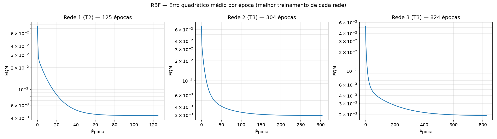

# Lab. Inteligência Artificial — Redes RBF

CEFET-MG Campus VIII – Varginha · Prof. Lázaro Eduardo da Silva · 04/11/2026

**Aluno(a):** ______________________________

Os resultados numéricos abaixo foram gerados por `rbf1.py` e `rbf2.py`.

---

## Configuração comum às duas redes

Treinamento em dois estágios:

1. **Camada escondida (não supervisionado):** algoritmo *k-means* em lote. Os centros
   iniciais são os N1 primeiros padrões considerados; a cada iteração cada padrão é
   associado ao centro mais próximo (distância euclidiana) e os centros passam a ser a
   média dos seus padrões, até que nenhum centro mude. A variância de cada cluster é
   `σ²_j = (1/m_j) · Σ ‖x − c_j‖²` sobre os m_j padrões do cluster.
2. **Camada de saída (supervisionado):** neurônio linear treinado pela regra delta
   generalizada (online), η = 0,01, bias como entrada fixa `−1` (peso W2(1,0)).
   Função de ativação dos neurônios escondidos: gaussiana
   `g(x) = exp(−‖x − c_j‖² / (2σ²_j))`.

- EQM por época: `E = (1/p) · Σ_k ½ · (d(k) − y(k))²`.
- Critério de parada: `|EQM(época) − EQM(época anterior)| ≤ ε`, com ε = 10⁻⁷.
- Pesos iniciais da camada de saída sorteados em [0, 1) com `numpy.random.default_rng`
  (semente 1 na RBF 1; sementes 1, 2 e 3 para T1, T2 e T3 na RBF 2).

---

## Parte 1 — RBF 1 (detecção de radiação)

Topologia 2-2-1. Saída desejada: presença de radiação = +1, ausência = −1.
O Anexo fornecido contém 40 padrões de treinamento (19 com presença de radiação).

### Item 1 — Camada escondida (k-means)

Como pede o enunciado, o k-means usou apenas os 19 padrões com presença de radiação (d = +1):

| Cluster | Centro (x1, x2) | Variância | Padrões no cluster |
|---|---|---|---|
| 1 | (0.1648, 0.6121) | 0.0298 | 6 |
| 2 | (0.3990, 0.1571) | 0.0385 | 13 |

### Item 2 — Camada de saída (regra delta generalizada)

Pesos iniciais: 0.5118, 0.9505, 0.1442 · Convergência em **309 épocas** · EQM final 0.117121

| Peso | Valor |
|---|---|
| W2(1,0) | 1.0019 |
| W2(1,1) | 2.3750 |
| W2(1,2) | 2.6964 |

Interpretação: com o bias `−1`, a saída é `y = −1,0019 + 2,3750·g₁ + 2,6964·g₂`. Longe dos
dois centros (g₁ ≈ g₂ ≈ 0) a rede responde ≈ −1 (ausência); perto de um dos centros
de radiação a saída sobe para valores positivos (presença).

### Item 3 — Pós-processamento

Implementado em `sinal()`, aplicado somente às saídas do conjunto de teste:

```
y_pós =  1, se y ≥ 0
        −1, se y < 0
```

### Item 4 — Validação

| Amostra | x1 | x2 | d | y | y pós | Acerto |
|---|---|---|---|---|---|---|
| 1 | 0.8705 | 0.9329 | -1 | -1.0018 | -1 | sim |
| 2 | 0.0388 | 0.2703 | +1 | -0.3229 | -1 | **não** |
| 3 | 0.8236 | 0.4458 | -1 | -0.9133 | -1 | sim |
| 4 | 0.7075 | 0.1502 | +1 | -0.2197 | -1 | **não** |
| 5 | 0.9587 | 0.8663 | -1 | -1.0018 | -1 | sim |
| 6 | 0.6115 | 0.9365 | -1 | -0.9870 | -1 | sim |
| 7 | 0.3534 | 0.3646 | +1 | 0.9659 | +1 | sim |
| 8 | 0.3268 | 0.2766 | +1 | 1.3227 | +1 | sim |
| 9 | 0.6129 | 0.4518 | -1 | -0.4677 | -1 | sim |
| 10 | 0.9948 | 0.4962 | -1 | -0.9959 | -1 | sim |

**Taxa de acerto: 8/10 = 80%** (no próprio conjunto de treinamento a rede acerta 37/40 = 92,5%).

### Item 5 — Estratégias para aumentar a taxa de acerto

Os dois erros (amostras 2 e 4) são padrões de presença de radiação que ficam **nas bordas**
da região de radiação, longe dos dois centros: a amostra 2 (x1 = 0,04) está à esquerda de
ambos os clusters e a amostra 4 (x1 = 0,71) à direita do cluster 2. Com apenas duas
gaussianas, as funções de ativação já valem pouco nesses pontos, e o bias (−1) prevalece.
Estratégias possíveis:

1. **Aumentar o número de neurônios na camada escondida** (mais clusters): a região de
   presença de radiação tem formato alongado/irregular e não é bem coberta por apenas duas
   gaussianas; com 3 ou 4 centros ela é coberta com mais fidelidade.
2. **Ajustar a abertura (variância) das gaussianas:** usar σ² maiores (por exemplo, um
   fator multiplicativo sobre a variância calculada, ou σ baseado na distância média entre
   centros) faz cada neurônio responder numa área maior, alcançando padrões de borda.
3. **Posicionar centros também para a classe de ausência:** aplicar o k-means sobre todos
   os padrões (ou nas duas classes separadamente) dá à camada de saída mais informação
   para traçar a fronteira, em vez de depender só do bias para a classe −1.
4. **Treinar os centros e variâncias de forma supervisionada** (ajuste por gradiente de
   c_j e σ_j junto com os pesos de saída), em vez de fixá-los pelo k-means.
5. **Melhorar a inicialização do k-means:** o resultado depende dos centros iniciais;
   executar o k-means várias vezes com inicializações diferentes (ou k-means++) e manter a
   solução de menor variância intra-cluster evita mínimos locais ruins.
6. **Mais dados de treinamento** nas regiões de fronteira, que são justamente onde a rede
   errou.

---

## Parte 2 — RBF 2 (quantidade de gasolina injetada)

Topologia 3-N1-1, com N1 = 5, 10 e 15. O k-means usou os 150 padrões de treinamento.
Os centros e variâncias de cada rede estão em `resultados_rbf2.md`.

### Itens 1 e 2 — Resultados dos treinamentos

| Treinamento | Rede 1 EQM | Rede 1 Épocas | Rede 2 EQM | Rede 2 Épocas | Rede 3 EQM | Rede 3 Épocas |
|---|---|---|---|---|---|---|
| 1º (T1) | 0.004323 | 129 | 0.002949 | 344 | 0.001915 | 834 |
| 2º (T2) | 0.004323 | 125 | 0.002949 | 333 | 0.001915 | 804 |
| 3º (T3) | 0.004322 | 112 | 0.002949 | 304 | 0.001915 | 824 |

**Por que T1, T2 e T3 dão praticamente o mesmo EQM?** Na RBF os centros e as variâncias
vêm do k-means, que é determinístico (não depende dos pesos sorteados). Com a camada
escondida fixa, a saída é **linear** nos pesos W2, e o EQM é uma função quadrática
(convexa) desses pesos, com um único mínimo global. Pesos iniciais diferentes mudam
apenas o caminho e o número de épocas até esse mínimo, não o ponto de chegada — ao
contrário do perceptron multicamadas, cuja superfície de erro tem vários mínimos locais.

### Item 3 — Validação

Erro relativo de cada amostra: `|d − y| / |d| × 100` (%). A variância é calculada sobre os
15 erros relativos de cada treinamento (variância populacional, em %²).

| Amostra | x1 | x2 | x3 | d | Rede 1 (T1) | Rede 1 (T2) | Rede 1 (T3) | Rede 2 (T1) | Rede 2 (T2) | Rede 2 (T3) | Rede 3 (T1) | Rede 3 (T2) | Rede 3 (T3) |
|---|---|---|---|---|---|---|---|---|---|---|---|---|---|
| 01 | 0.5102 | 0.7464 | 0.0860 | 0.5965 | 0.6079 | 0.6079 | 0.6080 | 0.5856 | 0.5857 | 0.5857 | 0.5910 | 0.5910 | 0.5910 |
| 02 | 0.8401 | 0.4490 | 0.2719 | 0.6790 | 0.7362 | 0.7362 | 0.7364 | 0.6749 | 0.6749 | 0.6749 | 0.6377 | 0.6377 | 0.6377 |
| 03 | 0.1283 | 0.1882 | 0.7253 | 0.4662 | 0.4360 | 0.4360 | 0.4363 | 0.4861 | 0.4861 | 0.4861 | 0.5089 | 0.5089 | 0.5089 |
| 04 | 0.2299 | 0.1524 | 0.7353 | 0.5012 | 0.4428 | 0.4429 | 0.4432 | 0.5043 | 0.5043 | 0.5043 | 0.5227 | 0.5227 | 0.5227 |
| 05 | 0.3209 | 0.6229 | 0.5233 | 0.6810 | 0.7027 | 0.7027 | 0.7028 | 0.6492 | 0.6492 | 0.6492 | 0.6642 | 0.6642 | 0.6642 |
| 06 | 0.8203 | 0.0682 | 0.4260 | 0.5643 | 0.5963 | 0.5963 | 0.5959 | 0.5330 | 0.5330 | 0.5330 | 0.5292 | 0.5292 | 0.5292 |
| 07 | 0.3471 | 0.8889 | 0.1564 | 0.5875 | 0.5434 | 0.5434 | 0.5433 | 0.5857 | 0.5857 | 0.5857 | 0.6009 | 0.6009 | 0.6009 |
| 08 | 0.5762 | 0.8292 | 0.4116 | 0.7853 | 0.8287 | 0.8288 | 0.8291 | 0.7591 | 0.7591 | 0.7591 | 0.7334 | 0.7334 | 0.7334 |
| 09 | 0.9053 | 0.6245 | 0.5264 | 0.8506 | 0.8245 | 0.8245 | 0.8248 | 0.8914 | 0.8914 | 0.8914 | 0.8156 | 0.8156 | 0.8156 |
| 10 | 0.8149 | 0.0396 | 0.6227 | 0.6165 | 0.5949 | 0.5948 | 0.5944 | 0.5935 | 0.5935 | 0.5935 | 0.6824 | 0.6824 | 0.6824 |
| 11 | 0.1016 | 0.6382 | 0.3173 | 0.4957 | 0.4639 | 0.4638 | 0.4637 | 0.5055 | 0.5055 | 0.5055 | 0.5294 | 0.5294 | 0.5294 |
| 12 | 0.9108 | 0.2139 | 0.4641 | 0.6625 | 0.6506 | 0.6505 | 0.6501 | 0.6150 | 0.6150 | 0.6150 | 0.5770 | 0.5770 | 0.5770 |
| 13 | 0.2245 | 0.0971 | 0.6136 | 0.4402 | 0.3713 | 0.3713 | 0.3717 | 0.4386 | 0.4386 | 0.4386 | 0.4705 | 0.4705 | 0.4705 |
| 14 | 0.6423 | 0.3229 | 0.8567 | 0.7663 | 0.7150 | 0.7150 | 0.7148 | 0.7585 | 0.7585 | 0.7585 | 0.7469 | 0.7469 | 0.7469 |
| 15 | 0.5252 | 0.6529 | 0.5729 | 0.7893 | 0.8832 | 0.8832 | 0.8834 | 0.8009 | 0.8009 | 0.8009 | 0.7550 | 0.7550 | 0.7550 |
| **Erro relativo médio (%)** | | | | | 6.6269 | 6.6262 | 6.6265 | 2.7805 | 2.7799 | 2.7797 | 5.7552 | 5.7551 | 5.7549 |
| **Variância (%²)** | | | | | 14.6940 | 14.6633 | 14.4852 | 4.3823 | 4.3868 | 4.3884 | 10.2691 | 10.2697 | 10.2707 |

### Item 4 — EQM × época do melhor treinamento de cada rede

O melhor treinamento de cada rede foi escolhido pelo menor erro relativo médio na validação
(as diferenças entre T1, T2 e T3 aparecem só na 4ª casa decimal):

| Rede | Treinamento | EQM final | Épocas | Erro relativo médio (%) | Variância (%²) |
|---|---|---|---|---|---|
| Rede 1 | T2 | 0.004323 | 125 | 6.6262 | 14.6633 |
| Rede 2 | T3 | 0.002949 | 304 | 2.7797 | 4.3884 |
| Rede 3 | T3 | 0.001915 | 824 | 5.7549 | 10.2707 |



(Escala logarítmica no eixo do EQM, para que a fase final do treinamento fique visível.)

### Item 5 — Topologia mais adequada

A **Rede 2 (N1 = 10) com a configuração final do treinamento T3** é a mais adequada:

- tem o **menor erro relativo médio** na validação (2,78%), menos da metade do das outras
  redes (6,63% na Rede 1 e 5,75% na Rede 3);
- tem também a **menor variância** (4,39 %²), ou seja, os erros são pequenos e
  homogêneos entre as amostras de teste;
- converge rapidamente (304 épocas).

A Rede 3 alcança o menor EQM de **treinamento** (0,001915), mas generaliza pior que a
Rede 2: com 15 gaussianas mais estreitas (variâncias entre 0,010 e 0,048) ela se ajusta
mais aos padrões de treinamento e perde capacidade de interpolar os pontos de teste — um
sinal de sobreajuste (*overfitting*). A Rede 1, com apenas 5 neurônios, é simples demais
para o mapeamento não linear do problema (maior EQM e maior erro de validação). Como
T1, T2 e T3 chegam praticamente ao mesmo ponto, qualquer um deles da Rede 2 seria
equivalente na prática; o T3 é o de menor erro relativo médio.
