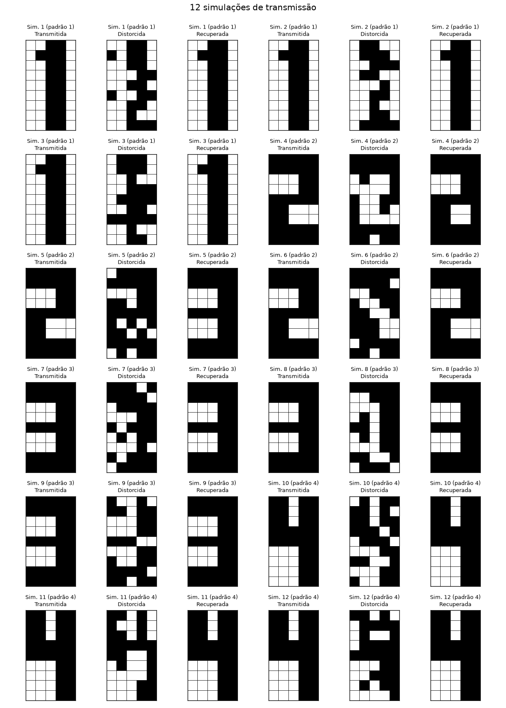
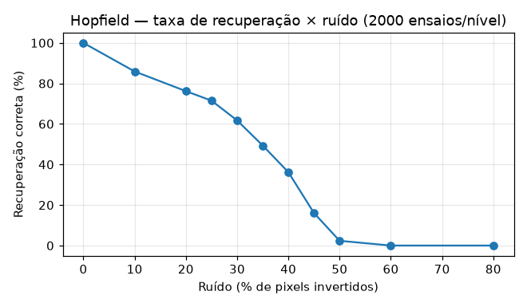
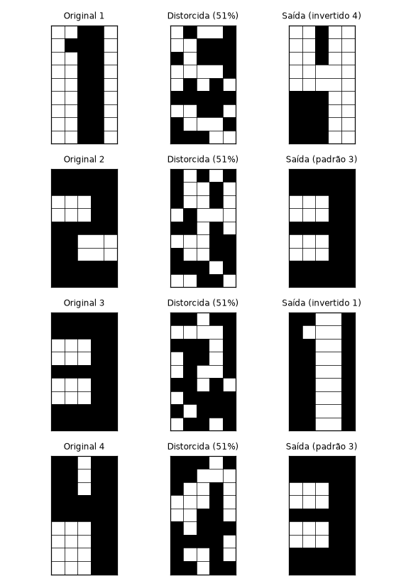

# Lab. Inteligência Artificial — Rede de Hopfield (memória associativa)

CEFET-MG Campus VIII – Varginha · Prof. Lázaro Eduardo da Silva · 12/11/2026

**Aluno(a):** Ramon Oliveira Silva

Resultados gerados por `hopfield.py` (saída completa em `resultados_hopfield.md`).

## Implementação

- **Rede:** 45 neurônios, um por pixel das imagens 9 × 5 (linhas × colunas, lidas por linha). Branco = −1, escuro = +1.
- **Padrões armazenados:** as 4 imagens do enunciado (dígitos 1, 2, 3 e 4), em `hopfield-treinamento.csv`.
- **Treinamento (regra do produto externo):** `W = (1/N) · Σₖ pₖ pₖᵀ`, com N = 45 e diagonal principal zerada (`wᵢᵢ = 0`).
- **Recuperação:** `v(t+1) = tanh(β · W · v(t))` com β = 1000 (praticamente a função sinal), atualização síncrona a partir da imagem distorcida, repetida até que a saída não mude mais.
- **Distorção:** cada imagem de teste tem exatamente 9 dos 45 pixels invertidos (20 %), conforme `hopfield-teste.csv`.

Correlação entre os padrões armazenados (`pᵢ·pⱼ / 45`) — quanto mais distante de 0, mais os padrões "se atrapalham":

| | 1 | 2 | 3 | 4 |
|---|---|---|---|---|
| **1** | 1,00 | −0,16 | 0,02 | −0,11 |
| **2** | −0,16 | 1,00 | **0,64** | 0,07 |
| **3** | 0,02 | **0,64** | 1,00 | 0,42 |
| **4** | −0,11 | 0,07 | 0,42 | 1,00 |

## Itens 1 e 2 — 12 simulações de transmissão

Para cada simulação, a figura mostra a imagem transmitida (livre de ruído), a distorcida (com ruído) e a imagem limpa recuperada pela rede.

| Simulação | Padrão transmitido | Pixels corrompidos | Iterações | Imagem recuperada | Resultado |
|---|---|---|---|---|---|
| 1 | 1 | 9 (20 %) | 1 | padrão 1 | ok |
| 2 | 1 | 9 (20 %) | 1 | padrão 1 | ok |
| 3 | 1 | 9 (20 %) | 1 | padrão 1 | ok |
| 4 | 2 | 9 (20 %) | 1 | **estado espúrio** | falhou |
| 5 | 2 | 9 (20 %) | 1 | **padrão 3** | falhou |
| 6 | 2 | 9 (20 %) | 1 | padrão 2 | ok |
| 7 | 3 | 9 (20 %) | 1 | padrão 3 | ok |
| 8 | 3 | 9 (20 %) | 1 | padrão 3 | ok |
| 9 | 3 | 9 (20 %) | 1 | padrão 3 | ok |
| 10 | 4 | 9 (20 %) | 1 | padrão 4 | ok |
| 11 | 4 | 9 (20 %) | 1 | padrão 4 | ok |
| 12 | 4 | 9 (20 %) | 1 | padrão 4 | ok |

**A rede recuperou corretamente 10 das 12 imagens (83 %).** As duas falhas são do padrão 2, que tem correlação de 0,64 com o padrão 3: os dois compartilham boa parte da região escura, então com 9 pixels trocados a dinâmica pode levar ao padrão 3 (simulação 5) ou a um estado que não coincide com nenhum dos quatro padrões, um estado espúrio (simulação 4). Os padrões 1 e 4 foram sempre recuperados.

Para medir isso melhor, simulei 2000 transmissões aleatórias (padrão e pixels sorteados) a 20 % de ruído: a recuperação correta ocorre em **76 %** dos casos (tabela do item 3).

## Item 3 — O que acontece quando o ruído aumenta excessivamente

Simulei 2000 transmissões para cada nível de ruído (padrão sorteado, pixels invertidos sorteados):

| Ruído | Recuperação correta | Outro padrão / imagem invertida | Estado espúrio |
|---|---|---|---|
| 0 % (0 pixels) | 100,0 % | 0,0 % | 0,0 % |
| 10 % (4 pixels) | 85,9 % | 0,8 % | 13,3 % |
| 20 % (9 pixels) | 76,2 % | 6,8 % | 17,1 % |
| 25 % (11 pixels) | 71,5 % | 9,3 % | 19,2 % |
| 30 % (14 pixels) | 61,8 % | 16,1 % | 22,2 % |
| 35 % (16 pixels) | 49,4 % | 25,5 % | 25,1 % |
| 40 % (18 pixels) | 36,2 % | 36,7 % | 27,1 % |
| 45 % (20 pixels) | 16,1 % | 53,5 % | 30,4 % |
| 50 % (22 pixels) | 2,4 % | 71,2 % | 26,4 % |
| 60 % (27 pixels) | 0,0 % | 71,8 % | 28,2 % |
| 80 % (36 pixels) | 0,0 % | 84,2 % | 15,8 % |

Exemplos com ~51 % de pixels invertidos (a rede entrega outra imagem, inclusive a **negativa** de um padrão):

**Explicação.** A rede de Hopfield é um sistema dinâmico cujos padrões armazenados são **atratores**: cada padrão tem uma *bacia de atração*, o conjunto de imagens que a dinâmica leva até ele. Enquanto o número de pixels trocados é pequeno, a imagem distorcida continua dentro da bacia do padrão original e a rede o recupera. Quando o ruído aumenta:

1. A imagem distorcida se afasta do padrão original e **atravessa a fronteira da bacia** de outro atrator. A rede converge com segurança, mas para o padrão errado (o de maior sobreposição com a imagem ruidosa), e a recuperação deixa de ser fiel.
2. Aparecem **estados espúrios**: pontos de equilíbrio que não são nenhum dos padrões armazenados, em geral combinações deles (como na simulação 4). Aqui eles são frequentes porque os padrões 2, 3 e 4 são correlacionados e a regra do produto externo cria "atalhos" entre eles.
3. Como `W` é simétrica e a função de ativação é ímpar, **a imagem invertida (negativo) de cada padrão também é um atrator**. Com ruído acima de 50 %, a imagem distorcida passa a ser mais parecida com o negativo do padrão original do que com ele, e a rede converge para o negativo. Por isso a recuperação correta cai para praticamente 0 % a partir de 50 %.
4. Em ruído muito alto (acima de ~50 %), a informação do padrão original praticamente desaparece da entrada: a saída depende de qual bacia a imagem aleatória caiu e não tem mais relação com o que foi transmitido.

Mesmo com ruído baixo a rede já erra em parte dos casos (14 % a 10 %), porque a correlação entre os padrões reduz a capacidade efetiva da memória; padrões mais ortogonais entre si, ou uma regra de aprendizado mais robusta (como a pseudoinversa), aumentariam a tolerância ao ruído.
