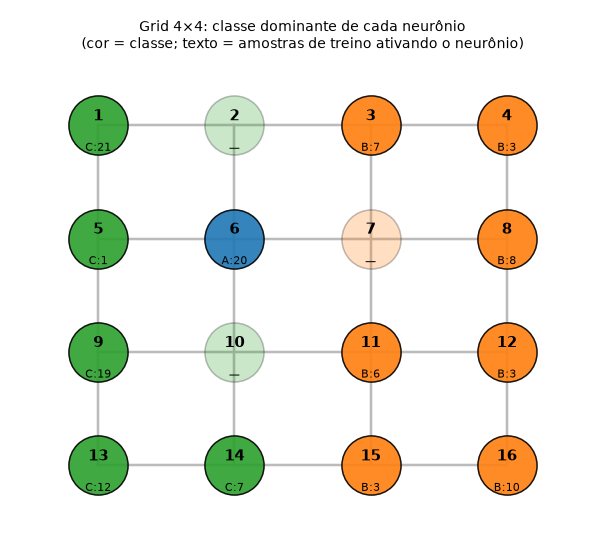
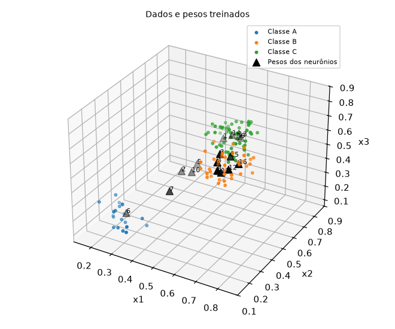

# Lab. Inteligência Artificial — Rede de Kohonen

CEFET-MG Campus VIII – Varginha · Prof. Lázaro Eduardo da Silva · 12/11/2026

**Aluno(a):** Ramon Oliveira Silva

Resultados gerados por `kohonen.py` (saída completa em `resultados_kohonen.md`).

## Configuração do treinamento

- **Topologia:** 3 entradas (x1, x2, x3) e N1 = 16 neurônios em grid 4 × 4, numerados por linha (1 a 4 na primeira linha, 5 a 8 na segunda, e assim por diante), como no diagrama do enunciado.
- **Vizinhança:** raio 1, isto é, o neurônio vencedor e os neurônios adjacentes a ele no grid, na horizontal e na vertical (conforme as ligações do diagrama).
- **Taxa de aprendizado:** η = 0,001.
- **Vencedor:** o neurônio de menor distância euclidiana ao padrão, `‖x − w_j‖`.
- **Atualização ("Norma Euclidiana"):** `w_j ← w_j + η (x − w_j)`, aplicada ao vencedor e aos vizinhos.
- **Pesos iniciais:** sorteados em [0, 1) (`numpy.random.default_rng`, semente 1). Os 120 padrões do apêndice são apresentados em cada época, na ordem dada.
- **Parada:** quando a maior variação de qualquer peso entre duas épocas fica abaixo de 10⁻⁶. Isso ocorreu em **1733 épocas**.

Pesos finais dos neurônios (cada linha é o vetor `(w_j1, w_j2, w_j3)`):

| Neurônio | w inicial | w final |
|---|---|---|
| 1 | (0.512, 0.950, 0.144) | (0.4671, 0.7564, 0.4690) |
| 2 | (0.949, 0.312, 0.423) | (0.4151, 0.4849, 0.4026) |
| 3 | (0.828, 0.409, 0.550) | (0.7110, 0.2757, 0.7921) |
| 4 | (0.028, 0.754, 0.538) | (0.7251, 0.2280, 0.7769) |
| 5 | (0.330, 0.788, 0.303) | (0.4292, 0.5941, 0.3837) |
| 6 | (0.453, 0.134, 0.403) | (0.2699, 0.2710, 0.1992) |
| 7 | (0.203, 0.262, 0.750) | (0.5004, 0.2390, 0.4792) |
| 8 | (0.280, 0.485, 0.981) | (0.7461, 0.1903, 0.7579) |
| 9 | (0.962, 0.725, 0.541) | (0.5524, 0.7555, 0.5066) |
| 10 | (0.277, 0.161, 0.970) | (0.4588, 0.4942, 0.4081) |
| 11 | (0.516, 0.116, 0.623) | (0.7312, 0.2481, 0.6971) |
| 12 | (0.777, 0.613, 0.917) | (0.7719, 0.2345, 0.7444) |
| 13 | (0.040, 0.529, 0.459) | (0.5464, 0.7459, 0.5216) |
| 14 | (0.062, 0.641, 0.853) | (0.5496, 0.6813, 0.5762) |
| 15 | (0.593, 0.260, 0.840) | (0.6968, 0.3907, 0.6888) |
| 16 | (0.509, 0.511, 0.753) | (0.7866, 0.2912, 0.7471) |

## Item 1 — Neurônios que respondem a cada classe

Depois do treinamento, apresentei os 120 padrões à rede e registrei qual neurônio venceu para cada um (entre parênteses, quantas amostras de treinamento cada neurônio venceu):

| Classe | Amostras | Neurônios do grid |
|---|---|---|
| **A** | 1–20 | **{ 6 }** (20 amostras) |
| **B** | 21–60 | **{ 3, 4, 8, 11, 12, 15, 16 }** (7, 3, 8, 6, 3, 3 e 10 amostras) |
| **C** | 61–120 | **{ 1, 5, 9, 13, 14 }** (21, 1, 19, 12 e 7 amostras) |

Nenhum neurônio respondeu a mais de uma classe: as três classes ficaram separadas no grid. Os neurônios **2, 7 e 10 nunca venceram** (são "neurônios de fronteira": ficam entre as regiões e têm pesos intermediários, como (0,50; 0,24; 0,48) para o 7). Se for preciso atribuí-los a uma classe, o critério natural é o neurônio ativo mais próximo em pesos: 2 e 10 junto da classe C, e 7 junto da B.

A classe A, de grandezas pequenas em todas as variáveis (≈ 0,25), concentra-se em um único neurônio; B tem x1 e x3 altos e x2 baixo; C tem x2 alto e x1, x3 médios. Isso aparece nos pesos: neurônios da classe B têm w₁ ≈ w₃ ≈ 0,7–0,8 e w₂ ≈ 0,2; os da C têm w₂ ≈ 0,6–0,8 e w₁ ≈ w₃ ≈ 0,4–0,6; o neurônio 6 (classe A) tem todos os pesos ≈ 0,2–0,3.

## Item 2 — Classe das amostras de teste

Cada amostra é atribuída à classe do neurônio vencedor (menor distância euclidiana):

| Amostra | x1 | x2 | x3 | Neurônio vencedor | Classe |
|---|---|---|---|---|---|
| 1 | 0.2471 | 0.1778 | 0.2905 | 6 | **A** |
| 2 | 0.8240 | 0.2223 | 0.7041 | 12 | **B** |
| 3 | 0.4960 | 0.7231 | 0.5866 | 14 | **C** |
| 4 | 0.2923 | 0.2041 | 0.2234 | 6 | **A** |
| 5 | 0.8118 | 0.2668 | 0.7484 | 16 | **B** |
| 6 | 0.4837 | 0.8200 | 0.4792 | 1 | **C** |
| 7 | 0.3248 | 0.2629 | 0.2375 | 6 | **A** |
| 8 | 0.7209 | 0.2116 | 0.7821 | 4 | **B** |
| 9 | 0.5259 | 0.6522 | 0.5957 | 14 | **C** |
| 10 | 0.2075 | 0.1669 | 0.1745 | 6 | **A** |
| 11 | 0.7830 | 0.3171 | 0.7888 | 16 | **B** |
| 12 | 0.5393 | 0.7510 | 0.5682 | 13 | **C** |

As amostras 1, 4, 7 e 10 são da classe A; 2, 5, 8 e 11 da classe B; 3, 6, 9 e 12 da classe C.

## Item 3 — Dedução da regra "Norma Euclidiana"

Para um padrão **x** apresentado à rede, seja *j* o neurônio vencedor. A função erro quadrático é

$$ E = ½ · Σᵢ ( w_ji − xᵢ )² $$

que é metade do quadrado da distância euclidiana entre o vetor de pesos **w**ⱼ e o padrão **x** (`E = ½ ‖w_j − x‖²`). Só os pesos do vencedor *j* aparecem em E.

**1. Gradiente.** Derivando em relação a um peso w_ji do vencedor (os demais termos da soma não dependem de w_ji):

`∂E/∂w_ji = ½ · 2 · (w_ji − x_i) · 1 = (w_ji − x_i)`

**2. Descida do gradiente.** Para minimizar E, cada peso é movido no sentido oposto ao gradiente, com passo proporcional à taxa de aprendizado η > 0:

`Δw_ji = −η · ∂E/∂w_ji = −η (w_ji − x_i) = η (x_i − w_ji)`

**3. Regra de atualização.**

`w_ji(t+1) = w_ji(t) + η (x_i − w_ji(t))`, ou em forma vetorial `w_j(t+1) = w_j(t) + η (x − w_j(t))`,

que é a regra "Norma Euclidiana": o vetor de pesos do vencedor é deslocado em direção a **x**, na fração η da distância que os separa. Em Kohonen a mesma atualização vale para os neurônios dentro do raio de vizinhança do vencedor; os demais não são alterados. ∎

**Verificação de que E de fato diminui.** Depois da atualização, `w_ji(t+1) − x_i = (1 − η)(w_ji(t) − x_i)`; logo

`E(t+1) = (1 − η)² · E(t)`,

e como 0 < η < 1, temos `E(t+1) < E(t)` para qualquer padrão com E > 0. A mesma função E explica também por que o vencedor é o neurônio de menor distância euclidiana: ele é o que tem o menor erro E para aquele padrão, ou seja, o ajuste que mais reduz o erro total.
