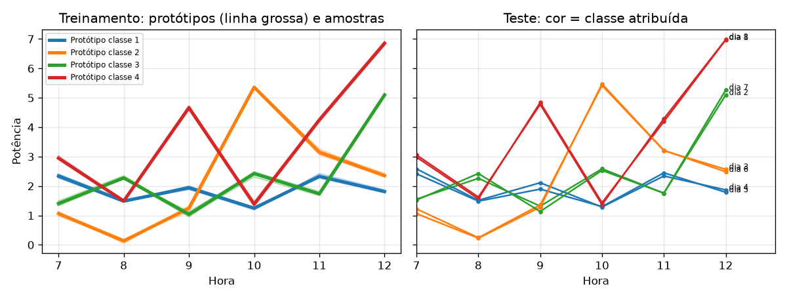

# Lab. Inteligência Artificial — Rede LVQ-1

CEFET-MG Campus VIII – Varginha · Prof. Lázaro Eduardo da Silva · 19/11/2026

**Aluno(a):** Ramon Oliveira Silva

Resultados gerados por `lvq.py` (saída completa em `resultados_lvq.md`).

## Enunciado

Previsão de potência elétrica a partir das medidas das primeiras horas do dia (7h a 12h). Há 16 dias medidos, agrupados em 4 classes (perfis) de demanda. A LVQ-1 deve aprender as regularidades de cada classe com taxa de aprendizagem η = 0,05 e depois classificar os 8 dias de teste.

## Implementação

- **Rede:** 6 entradas (potência às 7h, 8h, 9h, 10h, 11h e 12h) e 4 neurônios, um protótipo por classe.
- **Inicialização:** o protótipo de cada classe recebe a primeira amostra dessa classe (amostras 1, 5, 9 e 13).
- **Regra LVQ-1:** para cada padrão x, o vencedor j é o neurônio de menor distância euclidiana. Se a classe do neurônio coincide com a do padrão, o protótipo é aproximado (`w_j ← w_j + η (x − w_j)`); caso contrário, é afastado (`w_j ← w_j − η (x − w_j)`).
- **Treinamento:** η = 0,05; os 16 padrões são apresentados em cada época na ordem fornecida; parada quando a maior variação de peso entre épocas fica abaixo de 10⁻⁶. Convergiu em **50 épocas**.
- **Classificação:** a classe de um dia é a classe do neurônio de menor distância euclidiana.

## Pesos do treinamento

| Neurônio (classe) | Peso inicial | Peso final |
|---|---|---|
| 1 (classe 1) | 2.3976, 1.5328, 1.9044, 1.1937, 2.4184, 1.8649 | 2.3397, 1.4859, 1.9419, 1.2469, 2.3296, 1.8133 |
| 2 (classe 2) | 1.1201, 0.0587, 1.3154, 5.3783, 3.1849, 2.4276 | 1.0635, 0.1319, 1.2480, 5.3618, 3.1513, 2.3526 |
| 3 (classe 3) | 1.4871, 2.3448, 0.9918, 2.3160, 1.6783, 5.0850 | 1.4049, 2.2791, 1.0377, 2.4234, 1.7355, 5.0966 |
| 4 (classe 4) | 2.9364, 1.5233, 4.6109, 1.3160, 4.2700, 6.8749 | 2.9496, 1.4917, 4.6638, 1.3822, 4.2506, 6.8533 |

No conjunto de treinamento a rede acerta **16 de 16** amostras.

## Classificação dos dias de teste

| Dia | 7h | 8h | 9h | 10h | 11h | 12h | Neurônio vencedor | Classe | Distância |
|---|---|---|---|---|---|---|---|---|---|
| 1 | 2.9817 | 1.5656 | 4.8391 | 1.4311 | 4.1916 | 6.9718 | 4 | **4** | 0.2391 |
| 2 | 1.5537 | 2.2615 | 1.3169 | 2.5873 | 1.7570 | 5.0958 | 3 | **3** | 0.3574 |
| 3 | 1.2240 | 0.2445 | 1.3595 | 5.4192 | 3.2027 | 2.5675 | 2 | **2** | 0.3209 |
| 4 | 2.5828 | 1.5146 | 2.1119 | 1.2859 | 2.3414 | 1.8695 | 1 | **1** | 0.3060 |
| 5 | 2.4168 | 1.4857 | 1.8959 | 1.3013 | 2.4500 | 1.7868 | 1 | **1** | 0.1620 |
| 6 | 1.0604 | 0.2276 | 1.2806 | 5.4732 | 3.2133 | 2.4839 | 2 | **2** | 0.2091 |
| 7 | 1.5246 | 2.4254 | 1.1353 | 2.5325 | 1.7569 | 5.2640 | 3 | **3** | 0.2927 |
| 8 | 3.0565 | 1.6259 | 4.7743 | 1.3654 | 4.2904 | 6.9808 | 4 | **4** | 0.2445 |

**Classes dos dias de teste:** dia 1 → 4; dia 2 → 3; dia 3 → 2; dia 4 → 1; dia 5 → 1; dia 6 → 2; dia 7 → 3; dia 8 → 4.

## Análise

- As quatro classes têm perfis bem distintos nas primeiras horas, e por isso ficam bem separadas: a classe 1 é de demanda baixa e estável (≈ 1,2 a 2,4); a classe 2 tem queda forte às 8h (≈ 0,1) e pico às 10h (≈ 5,4); a classe 3 tem demanda média e sobe às 12h (≈ 5,1); a classe 4 é a de maior demanda, com picos às 9h e às 12h.
- Todos os dias de teste ficaram a distância pequena (de 0,16 a 0,36) do protótipo vencedor, bem menor que a distância entre protótipos de classes diferentes. Isso indica classificações seguras, sem casos ambíguos.
- Conhecida a classe do dia a partir das primeiras horas, o respectivo perfil de potência (protótipo) serve como previsão para as horas seguintes.
- Os resultados dependem da inicialização escolhida (primeira amostra de cada classe); testei 200 inicializações aleatórias (uma amostra sorteada de cada classe) e todas classificaram os 8 dias de teste exatamente como acima.
